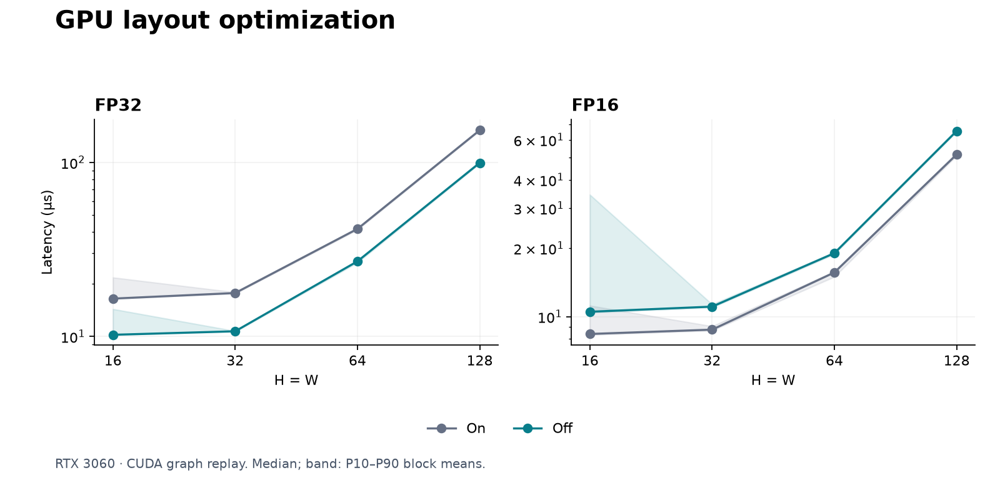

# GPU layout regression

**FP32: 1.54–1.66× faster with layout optimization off.** FP16: 1.22–1.27× slower.

Only `torch.compile(..., options={"layout_optimization": False})` changes. All 16 configurations pass ordinary and captured-graph checks.

| Precision | H=W | On (µs) | Off (µs) | On/off time |
|---|---:|---:|---:|---:|
| FP32 | 16 | 16.50 | 10.22 | 1.61× |
| FP16 | 16 | 8.38 | 10.50 | 0.80× |
| FP32 | 32 | 17.77 | 10.71 | 1.66× |
| FP16 | 32 | 8.76 | 11.06 | 0.79× |
| FP32 | 64 | 41.49 | 27.02 | 1.54× |
| FP16 | 64 | 15.64 | 19.02 | 0.82× |
| FP32 | 128 | 152.97 | 99.37 | 1.54× |
| FP16 | 128 | 51.73 | 65.59 | 0.79× |

At FP32 16×16, the separate profile drops from **8 to 3 kernels/call**; the layout conversions disappear. At FP16 16×16, it rises from **4 to 5**.

One AC desktop session; clocks unlocked. 25 blocks/configuration; five profiled calls. Reordering and kernel selection change together.

[Raw measurements and kernel names](../../results/rtx3060-layout-2026-10-13.json)
