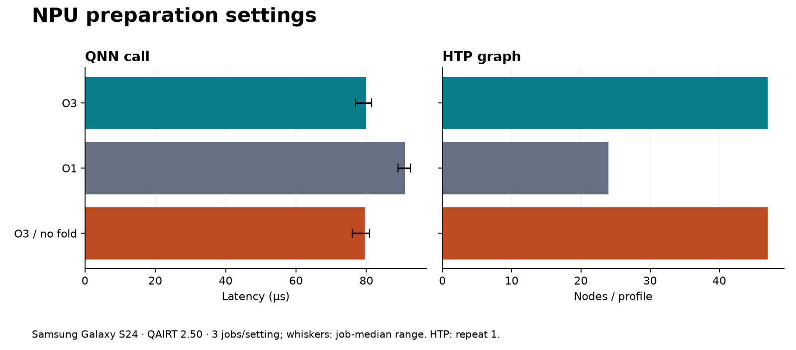

# NPU preparation settings

**9 jobs validated.** `conv_b1_c32_h16_o64`; FP32 I/O, requested FP16, QAIRT 2.50.

HTP options are explicitly set on inference jobs. 3 separate jobs per setting; each passes correctness and NPU-placement checks.

| Setting | Median (µs) | Job-median range (µs) | HTP nodes |
|---|---:|---:|---:|
| O3 | 80.0 | 77.0–81.5 | 47 |
| O1 | 91.0 | 89.0–92.5 | 24 |
| O3 / no fold | 79.5 | 76.0–81.0 | 47 |

Single shape; uncontrolled cloud device assignment. HTP counts are diagnostic, not a predictor of latency.

[Flag-placement audit](../preparation-audit/report.md) · [Raw jobs](../../results/hub-s24-preparation-2026-10-14/results.json) · [HTP evidence](../../results/hub-s24-preparation-2026-10-14/htp-review.json)
