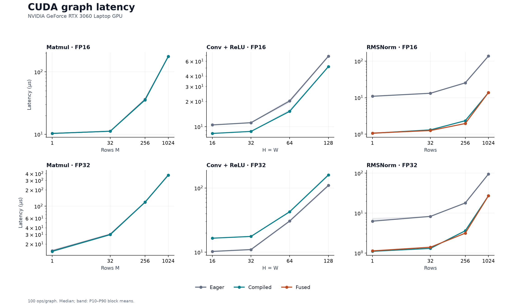
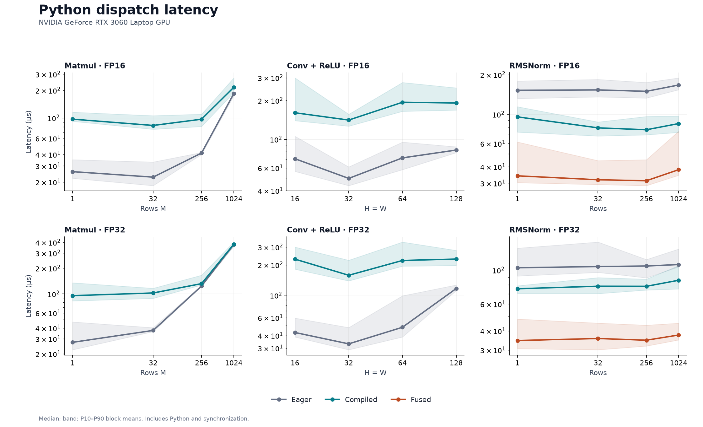
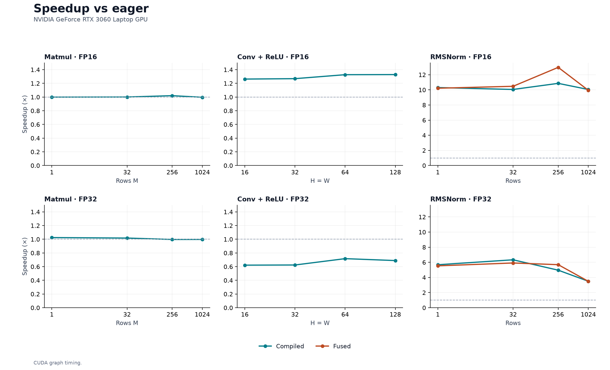
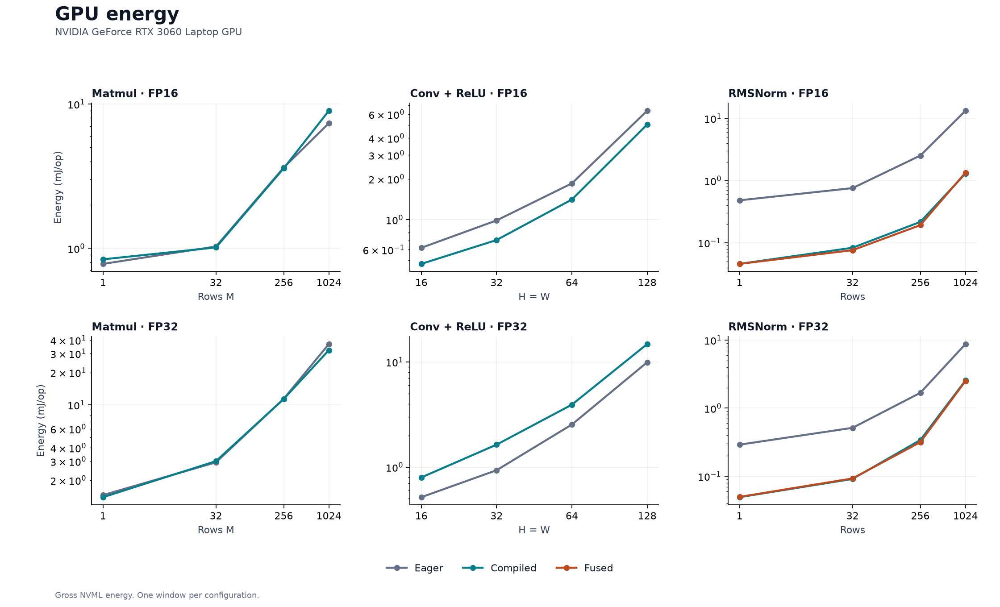
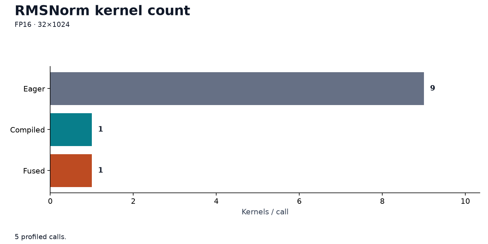

# RTX 3060

**56/56 configurations passed.** NVIDIA GeForce RTX 3060 Laptop GPU, 6 GiB.

PyTorch 2.11.0+cu128 · CUDA 12.8 · driver 616.64.

| Metric | Boundary |
|---|---|
| Graph latency | Resident inputs; 100 calls per graph |
| Dispatch latency | Python calls + synchronization; no transfers |
| Energy | Separate sustained replay; gross NVML device energy |

Bands: P10–P90 block means, not confidence intervals. One session; clocks unlocked.

Matmul K=N=1024; convolution C=32→64, kernel=3; RMSNorm width=1024. TF32 off.

## CUDA graph latency

## Python dispatch latency

## Speedup vs eager

## GPU energy

## Compiler evidence

[Raw profiler evidence](../../results/rtx3060-ac-rmsnorm-profile.json)

## Numerical error

CPU FP64 reference; ordinary and captured-graph outputs checked.

| Operation | Precision | Max relative L2 error |
|---|---|---:|
| Matmul | float16 | 3.727e-04 |
| Matmul | float32 | 3.340e-07 |
| Conv + ReLU | float16 | 3.607e-04 |
| Conv + ReLU | float32 | 2.037e-07 |
| RMSNorm | float16 | 3.729e-04 |
| RMSNorm | float32 | 7.509e-08 |

## Raw evidence

- [Flat measurement table](measurements.csv)
- [Raw data and run conditions](../../results/rtx3060-ac-2026-10-13.json)
- Source: `399b19c7b4750360dc917fdc7f4d9a71db579350`; dirty: `False`; UTC: 2026-10-14T00:43:30.933841+00:00.
- `first_call_s` includes initialization and possible cache hits; not isolated compile time.
- NPU timing has a different boundary; NPU power is unavailable.
