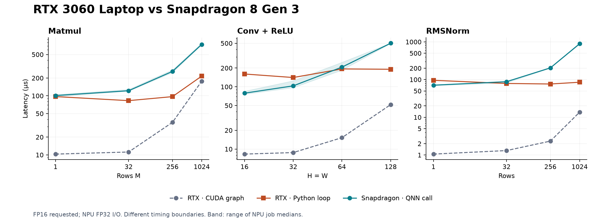
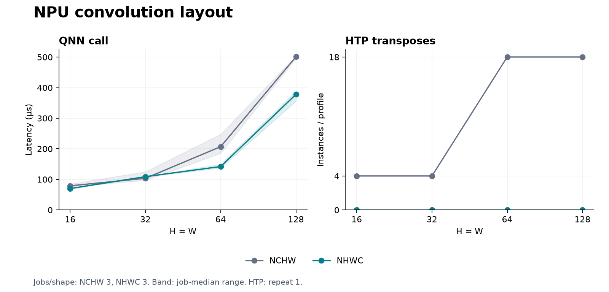

# RTX 3060 Laptop vs Snapdragon 8 Gen 3

**84/84 NPU jobs validated**, 3 jobs per compile request. Same 12 shapes and input/weight hashes.

GPU: RTX 3060 Laptop, PyTorch compiled FP16. NPU: Samsung Galaxy S24, QAIRT 2.50, compile request O3, requested FP16, FP32 I/O.

Timing boundaries differ: CUDA graph, block-timed Python dispatch, and QNN framework call. No chip-only speedup ratio or NPU energy estimate.

| Case | GPU graph (µs) | GPU Python loop (µs) | NPU QNN (µs) |
|---|---:|---:|---:|
| Matmul M=1 | 10.31 | 97.00 | 101.0 |
| Matmul M=32 | 11.18 | 82.81 | 122.0 |
| Matmul M=256 | 35.54 | 96.85 | 259.0 |
| Matmul M=1024 | 176.90 | 215.62 | 742.0 |
| Conv H=W=16 | 8.31 | 160.53 | 79.0 |
| Conv H=W=32 | 8.79 | 140.92 | 103.5 |
| Conv H=W=64 | 15.24 | 193.57 | 207.0 |
| Conv H=W=128 | 51.76 | 191.13 | 501.0 |
| RMSNorm rows=1 | 1.06 | 95.66 | 71.0 |
| RMSNorm rows=32 | 1.31 | 78.95 | 88.0 |
| RMSNorm rows=256 | 2.34 | 76.36 | 204.5 |
| RMSNorm rows=1024 | 13.69 | 85.06 | 893.0 |

NPU points: median of job medians. Bands: minimum–maximum job medians, not confidence intervals.

HTP preparation flags were supplied only at DLC conversion. Their device-side application was not verified; this run does not establish O3/O1 or folding effects. [Archived request comparison](compiler_settings.png).

## Numerical error

| Operation | GPU max relative L2 | NPU max relative L2 |
|---|---:|---:|
| Matmul | 3.727e-04 | 3.725e-04 |
| Conv + ReLU | 3.607e-04 | 3.607e-04 |
| RMSNorm | 3.729e-04 | 3.732e-04 |

CPU FP64 reference; NPU baseline and GPU compiled FP16.

## Layout ablation

Same convolution and weights; only the I/O layout changes. Input/output reordering is outside timing.

Separate sweeps; cloud device allocation and execution order were uncontrolled.

| H=W | NCHW (µs) | NHWC (µs) | Speedup |
|---:|---:|---:|---:|
| 16 | 79.0 | 70.0 | 1.13× |
| 32 | 103.5 | 109.0 | 0.95× |
| 64 | 207.0 | 142.0 | 1.46× |
| 128 | 501.0 | 378.0 | 1.33× |

## Evidence

- [Comparison table](comparison.csv)
- [Reviewed measurements](review.json)
- [Raw NPU jobs](../../results/hub-s24-sweep-2026-10-13/results.json)
- [Workload shapes and hashes](../../results/hub-s24-sweep-2026-10-13/export-manifest.json)
- [GPU measurements](../../results/rtx3060-ac-2026-10-13.json)
- [Timing definition](https://workbench.aihub.qualcomm.com/docs/hub/howitworks-inference.html)
- [HTP diagnostics](https://docs.qualcomm.com/doc/80-63442-10/topic/htp_backend.html#qnn-htp-analysis-summary-qhas)
- [NCHW HTP evidence](../../results/hub-s24-sweep-2026-10-13/htp-review.json)
- [NHWC jobs](../../results/hub-s24-nhwc-2026-10-13/results.json)
- [NHWC HTP evidence](../../results/hub-s24-nhwc-2026-10-13/htp-review.json)
