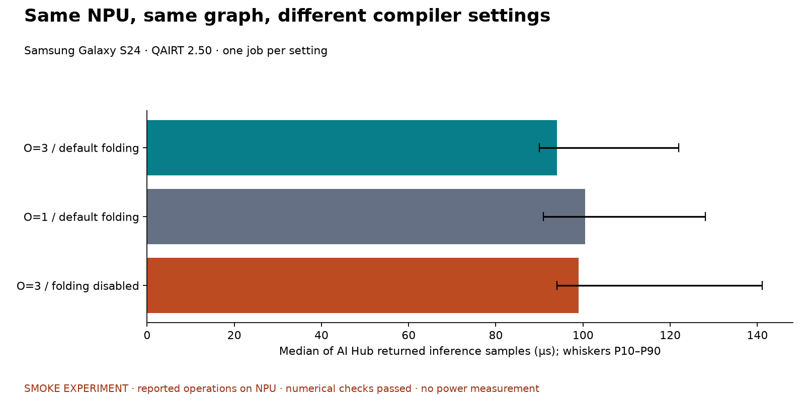

# Snapdragon NPU: first compiler experiment

Device: **Samsung Galaxy S24**. Requested QAIRT: **2.50**.

Real AI Hub measurements of the same seeded workload as the local suite: `conv_b1_c32_h32_o64`. Shapes and input/weight hashes are preserved in the export manifest. FP32 IO with requested FP16 execution. Requested performance mode: sustained high performance.

One job per setting. These establish that the pipeline works; they do not establish a statistically reliable optimization benefit. Power is unavailable. No RTX-versus-NPU speedup is calculated because timing boundaries and local background activity differ.

| Requested setting | AI Hub estimate (µs) | Median of returned samples (µs) | P10–P90 (µs) | Numerical check | Reported placement |
|---|---:|---:|---:|---|---|
| optimized | 82.0 | 94.0 | 90.0–122.0 | pass | NPU |
| prepare_fast | 86.0 | 100.5 | 90.9–128.1 | pass | NPU |
| no_conv_relu_fold | 92.0 | 99.0 | 94.0–141.1 | pass | NPU |

## Interpretation limits

- All returned samples are included in our median/P10/P90, including startup outliers. The SDK's estimate is a separate metric; we do not assume its aggregation matches our median.
- All listed profile entries must report NPU before a result appears in the chart. Host framework work is still part of the timing boundary.
- Disabling folding is a requested ablation. Logical layer names and zero-cycle entries do not prove whether the compiler physically fused the operations; `fusion_verified` remains false.
- Requested FP16 execution and numerical agreement are documented. Detailed internal accumulation precision is not independently verified.
- Repeat jobs in randomized order and inspect deeper compiler/runtime evidence before attributing latency differences to one optimization.

## Evidence

- [Machine-readable profile review](profile-review.json)
- [optimized inference job](https://workbench.aihub.qualcomm.com/jobs/jprxn1q7p/) (account access may be required)
- [prepare_fast inference job](https://workbench.aihub.qualcomm.com/jobs/jpx0dm98p/) (account access may be required)
- [no_conv_relu_fold inference job](https://workbench.aihub.qualcomm.com/jobs/j56odven5/) (account access may be required)
